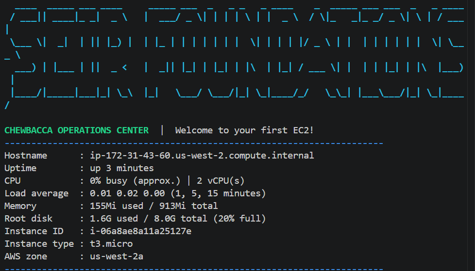
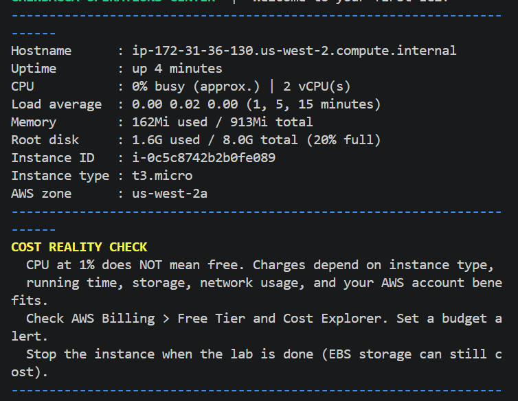
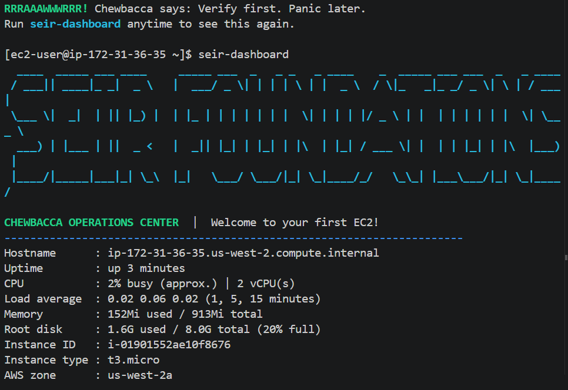

# SEIR Foundations — Lab 0: Your First EC2 Dashboard

| **Deployment** | **Public IPv4 address** | **Connection method** | **Screenshot** | **Instance terminated?** |
|---|---|---|---|---|
| 1 | `52.11.2.190` | SSH (Git Bash) | **Screenshot 1**  | Yes |
| 2 | `35.90.51.199` | SSH (Git Bash) | **Screenshot 2**  | Yes |
| 3 | `35.88.76.206` | SSH (Git Bash) | **Screenshot 3**  | Yes |

